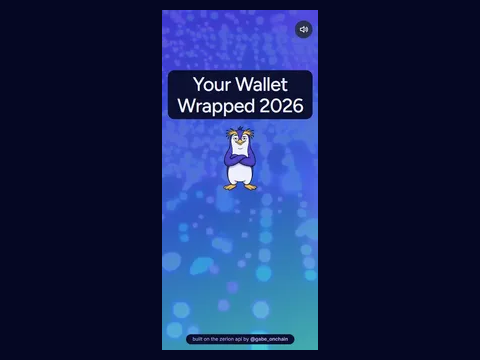
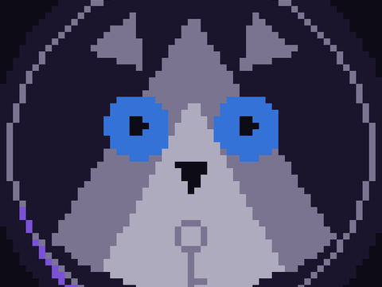
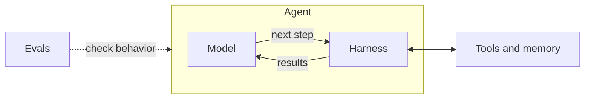

# Gabriel Abreu (Gabe)

Hiii, I'm Gabe. I've worked for the past 15 years somewhere between why it matters and how it works in all things marketing, but esp. writing, ghostwriting, growth & socials. 

Since Feb 2025 I build AI agents: MCP servers, LLM evals, human-in-the-loop approvals, harnesses, workflows & plugins. In short, tons of agent plumbing that helps people in their work and everyday lives.

In 2026 I finished an MBA in applied AI software engineering at UniPDS (480 hours): AI systems architecture, MCP, autonomous agents, fine-tuning (LoRA, PEFT), AI security & governance.

Stack: Python, TypeScript, Node.js, Fastify, Rust, PyTorch, pandas, MCP, LLM evals, RAG, Claude Code, AWS, SQL, MongoDB, React, Next.js, Vite.

Open to remote roles worldwide and hybrid roles in Rio de Janeiro or São Paulo. [Resume](https://gabeonchain.com/resume) · [Book a call](https://calendly.com/gavafotos/30min)

| Path | What I do |
|:--|:--|
| [Marketing](https://gabeonchain.com/marketing) · Marketing Engineer, Marketer & Writer | I shape brand narrative & write it everywhere: ghostwriting, content marketing, socials, launches, product education & SEO/AEO. |
| [Engineering](https://gabeonchain.com/engineering) · Forward Deployed Engineer & Product Engineer | I help teams work better with AI, from finding the problem to building the fix with AI agents, MCP servers & evals, and bringing people along. |

How I work: [Intro video](https://www.youtube.com/watch?v=BBRXK4ttBz8) · [Creative video](https://x.com/gabe_onchain/status/2102126157378249038?s=20) · [Building with AI](https://github.com/gabchess/operating-thoughts/blob/main/how-i-think-about-ai.md)

##  Open source

Public repos you can read, run & fork. Scout and Hedwig are MCP servers you can install in your agent.

| Project | What it does | Language | Access |
|:--|:--|:--|:--|
| [Scout](https://github.com/gabchess/scout-onchain) | An MCP server that gives your agent onchain analytics: wallet lookup, PnL and DCA proposals that wait for your approval. | Python | Open source, MIT |
| [Hedwig](https://github.com/gabchess/hedwig) | An MCP server that agents & humans consult before anything onchain. | JavaScript, TypeScript | Open source, MIT |
| [Webhook reconcile](https://github.com/gabchess/helius-webhook-reconcile) | Finds the Helius webhook events your log missed, refetches them and writes a backfill you can replay. | Rust | Open source, MIT |
| [Solana tx doctor](https://github.com/gabchess/solana-tx-doctor) | Names why a Solana transaction failed: a Rust CLI on Helius, an Anchor program that fails on purpose & a Claude Code skill. | Rust | Open source |

##  Building now

- **[Maria](https://meetmaria.app):** A live iOS app that gives older adults a plain-language second opinion on a suspicious message. I worked across the product, interface & AI workflow. React Native, Expo & TypeScript for the app, TensorFlow & PyTorch for the model.
- **[Thoth](https://github.com/gabchess/thoth):** A self-improving agent harness built around search and learning. It retrieves from RAG evaluated with RAGAS, has a finished LoRA fine-tune & learns from human evals. In development, private.

<table>
  <tr>
    <td align="center" valign="top" width="33%">
      
       <b>Maria</b> An iOS app that checks suspicious texts for older adults
    </td>
    <td align="center" valign="top" width="33%">
      
       <b>Wallet Wrapped</b> A crypto wallet's year as a story you can share
    </td>
    <td align="center" valign="top" width="33%">
      
       <b>Hedwig</b> An MCP server that checks an onchain payment before it goes out
    </td>
  </tr>
</table>

##  Marketing workflows

| Project | What it does |
|:--|:--|
| [Prospector](https://github.com/gabchess/prospector) | Researches accounts with sources and prepares a shortlist. A person approves before anything is exported. |
| [Launch Factory](https://github.com/gabchess/launch-factory) | An AI agent drafts launch assets from release files. Python validates and renders them, and a person approves the claims. |
| [TAM mapper](https://github.com/gabchess/gtm-tam-mapper) | Maps every account that could buy from you, deduped. |
| [Wallet Wrapped](https://gabeonchain.com/wallet-wrapped) | Turns a crypto wallet's year into a 13-screen story and a card to share. Built on the Zerion API. MVP demo. |

5 more workflows

| Project | What it does |
|:--|:--|
| [Outbound personalizer](https://github.com/gabchess/gtm-outbound-personalizer) | Adapts outbound copy to each account segment. |
| [Objections to content](https://github.com/gabchess/gtm-objections-to-content) | Turns sales-call objections into a content calendar. |
| [Campaign launcher](https://github.com/gabchess/gtm-campaign-launcher) | Checks lead lists and email sequences before launch. |
| [Content repurposer](https://github.com/gabchess/gtm-content-repurposer) | Finds relevant material in your published work. |
| [Campaign analyzer](https://github.com/gabchess/gtm-campaign-analyzer) | Compares campaign results by audience and copy variant. |

##  Custom AI harnesses

An AI harness gives a model the tools, memory and controls to work through a task.

The model chooses the next step. The harness runs the permitted tools, keeps context and feeds the results back. Evals check how the system behaves.

4 private harnesses

| Harness | What it does | Access |
|:--|:--|:--|
| [HyperBots](https://github.com/gabchess/HyperBots) | A multi-agent setup that coordinates specialist agents for software and marketing work. | Private, invite-only |
| [OpSec](https://github.com/gabchess/BountyHarness) | Takes security research from code review to QA, PR & PoC. | Private, invite-only |
| [Video-show](https://github.com/gabchess/video-show) | Runs video production as a gated workflow, with a person approving the final cut. | Private, invite-only |
| [Product Machine](https://github.com/Maquina-de-Produtos) | Creates, sells and upsells low-ticket products end to end. | Private, invite-only |

###  Augments

An augment packages a workflow for your AI assistant as a plugin or skill folder. I build them for content teams and developers.

6 augments

| Augment | What it does | Access |
|:--|:--|:--|
| [Designer](https://github.com/gabchess/cinematic-site-builder) | Builds animated [portfolio sites](https://gabeonchain.com/) from a brief, with SEO and AEO, and checks each build in a real browser. | Private, invite-only |
| [Researcher](https://github.com/gabchess/augments/tree/main/Researcher) | Researches a question and keeps full sources, partial previews and guesses apart. | Private, invite-only |
| [Clipper](https://github.com/gabchess/augments/tree/main/Clipper) | Finds the video, lets you pick the moment, then cuts the clip and writes its posts. | Private, invite-only |
| [Job scout](https://github.com/gabchess/job-agent-private) | Finds roles that fit, then drafts the outreach for human review. | Private, invite-only |
| [3Demo](https://github.com/gabchess/knowledge-islands) | Turns a topic into a 3D world you walk through as one offline HTML presentation. | Private, invite-only |
| [Tixmancer](https://tixmancer.xyz) | An AI agent that hunts secondhand finds within your budget. | In development, with a waitlist |

##  Skills

Agent skills I ship in [gabchess/skills](https://github.com/gabchess/skills). Each folder teaches an agent one workflow, and any harness that reads SKILL.md can load it. Private, invite-only.

| Skill | What it does |
|:--|:--|
| [gabe-voice](https://github.com/gabchess/skills/tree/main/skills/disciplines/gabe-voice) | My writing rules for agents. |
| [review-change](https://github.com/gabchess/skills/tree/main/skills/reviews/review-change) | Reviews against the repo's standards and once against the task, and returns a verdict for each. |
| [crash-lab](https://github.com/gabchess/skills/tree/main/skills/quality/crash-lab) | Tests whether an edit to an agent's instructions improves its work or quietly breaks it, in fresh sandboxed sessions. |
| [3d-cinematic-website](https://github.com/gabchess/skills/tree/main/skills/websites/3d-cinematic-website) | Turns one page of your site into a cinematic scroll scene, approved before anything else is built. |

17 more skills

**Harnesses**

- [join-factory](https://github.com/gabchess/skills/tree/main/skills/harnesses/join-factory): Points a harness at my shared agent rules, links these skills into it and proves it loads them.

**Learning**

- [teach-gabe](https://github.com/gabchess/skills/tree/main/skills/learning/teach-gabe): Teaches me a concept or workflow as one short HTML lesson with every claim sourced, or quizzes me on why we made a decision.

**Marketing**

- [launch-factory](https://github.com/gabchess/skills/tree/main/skills/marketing/launch-factory): Picks the product change worth announcing and writes six launch drafts, each traced to its source, for a person to publish.
- [prospector](https://github.com/gabchess/skills/tree/main/skills/marketing/prospector): Researches B2B accounts into a checked lead shortlist, or recommends the next move on an open deal. It never sends a message.
- [tam-mapper](https://github.com/gabchess/skills/tree/main/skills/marketing/tam-mapper): Merges company-list exports into one deduped TAM scored against your ICP, and names every dropped account with its reason.

**Marketplace**

- [sell-on-agensi](https://github.com/gabchess/skills/tree/main/skills/marketplace/sell-on-agensi): Packages a finished skill for Agensi: a ZIP whose scripts each run alone, plus a filled listing.
- [plugin-packager](https://github.com/gabchess/skills/tree/main/skills/marketplace/plugin-packager): Packages one finished skill as a plugin for Claude Code, Cowork, Codex and ChatGPT, in one zip that you upload yourself.

**Orchestration**

- [orchestrate-task](https://github.com/gabchess/skills/tree/main/skills/orchestration/orchestrate-task): Runs one task through a worker with a loop cap and stops with a clear ask after two failed attempts.

**Research**

- [web-reach](https://github.com/gabchess/skills/tree/main/skills/research/web-reach): Reads a page, post or thread in full through at most three fetch steps, and ends each read with one outcome a script checks.
- [research-ledger](https://github.com/gabchess/skills/tree/main/skills/research/research-ledger): Researches a question from sources read in full and keeps a ledger of cited claims, with a fresh agent checking the quotes.

**Quality**

- [loading-probe](https://github.com/gabchess/skills/tree/main/skills/quality/loading-probe): Checks which instruction files and skills a harness loads, and whether it follows a rule planted in them.
- [agentic-dead-rules-detector](https://github.com/gabchess/skills/tree/main/skills/quality/agentic-dead-rules-detector): Tests whether one rule in an agent's instructions changes its work, with every number from one script.
- [agent-governance-gate](https://github.com/gabchess/skills/tree/main/skills/quality/agent-governance-gate): Audits an agent repo for security, privacy and ownership gaps, then builds a policy that fails closed.

**Solana**

- [solana-tx-doctor](https://github.com/gabchess/skills/tree/main/skills/solana/solana-tx-doctor): Reads a failed Solana transaction and names the cause, quoting the log line that proves it. It only reads the chain.

**Visuals**

- [social-diagrams](https://github.com/gabchess/skills/tree/main/skills/visuals/social-diagrams): Turns a social post into a hand-drawn whiteboard diagram and hands it back as a PNG.

**Websites**

- [share-storyboard](https://github.com/gabchess/skills/tree/main/skills/websites/share-storyboard): Plans a share-first page or card, like a recap or a card drop, up to one approved storyboard before anything is built.
- [knowledge-islands](https://github.com/gabchess/skills/tree/main/skills/websites/knowledge-islands): Turns a topic into a 3D world of floating islands, one island per idea, in one offline HTML file.

##  Writing

I started with poems and short stories as a teen. Globo found me through my chess blog, and in 2021 I advised the cast of “Um Lugar ao Sol” on chess. Most recently, I wrote for 10+ Web3 brands and ghostwrote for crypto creators & a finance executive. Now I write about all things AI, marketing, and what I learn from building on [my blog](https://gabeonchain.com/blog.html).

<table>
  <tr>
    <td align="center" valign="top" width="33%">
      
       <b>How I could provide ROI right away</b>
    </td>
    <td align="center" valign="top" width="33%">
      
       <b>Is it OK to let AI be your copy editor?</b>
    </td>
    <td align="center" valign="top" width="33%">
      
       <b>Lessons on building a banger portfolio website with AI</b>
    </td>
  </tr>
</table>

##  Security research

On Immunefi, Quantus paid me for 2 findings: 1 High and 1 Medium. I wrote up a byte-offset bug in Anchor's `LazyAccount` as a [pull request in my fork](https://github.com/gabchess/anchor/pull/1), with a proof of concept and a fix. I also built a native SOL vault [extension to the Solana Vault Standard](https://github.com/gabchess/solana-vault-standard/tree/feat/svs-7-native-sol-vault).

##  SEO/AEO/GEO

At a barbecue, a childhood friend told me his painting studio needed more students. I built a landing page for his studio with local SEO and structured data for search and AI discovery. A few weeks later, demand had grown enough that he had to open a waitlist.

##  Also built

[Clawmanship](https://github.com/gabchess/clawmanship) · [SafeSkill](https://github.com/gabchess/safeskill) · [Grimoire](https://github.com/gabchess/grimoire) · [Solana Ship Gate](https://github.com/gabchess/solana-ship-gate) · [Solana Narrative Tracker](https://github.com/gabchess/solana-narrative-tracker) · [Prediction Pari Market](https://github.com/gabchess/worldcup-pari-market) · [Privacy for Solana](https://github.com/gabchess/kageb) · [Patronus](https://github.com/gabchess/patronus) · [SolGuard](https://github.com/gabchess/solguard) · [Agenthub](https://github.com/gabchess/agenthub) · [E-commerce Data Analysis with pandas](https://github.com/gabchess/ecommerce-sales-analysis) · [WalletBrief for Monad](https://github.com/gabchess/walletbrief-monad)

---

[Resume](https://gabeonchain.com/resume) · [X](https://x.com/gabe_onchain) · [LinkedIn](https://www.linkedin.com/in/gabeonchain) · [Contact](https://gabeonchain.com/contact.html)

Back to building ⚒️

